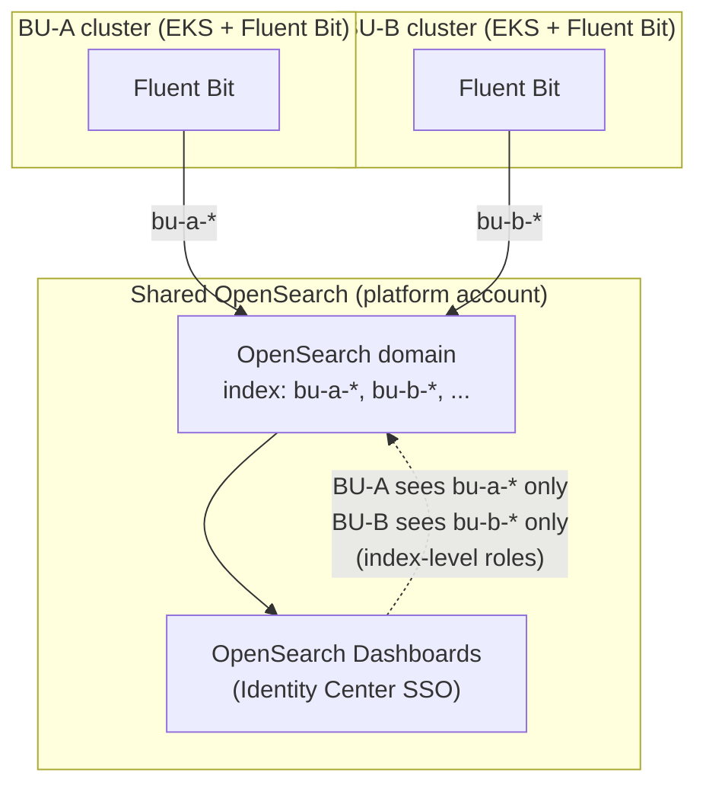
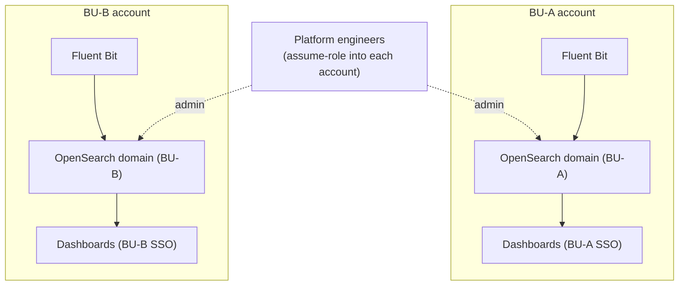
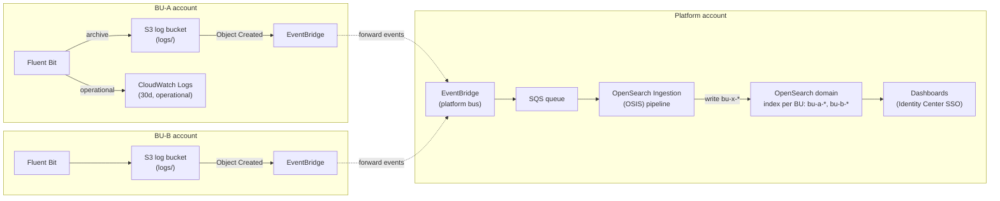

# ADR-017: Logging and Log Management Architecture

**Status:** Proposed — Phase 1 PoC validation required. The OpenSearch deployment model (the
"OpenSearch — Full-Text Log Search" section) is Accepted and in build (#8420), conditional on
security sign-off on logical isolation.
**Date:** 2026-07-22 (OpenSearch deployment model merged in October)
**Decision Maker:** AWS ProServe / MoJ Principal Technical Architect
**Category:** Observability

This ADR now also covers the OpenSearch deployment model, previously a separate doc also numbered
017; the two were merged into one.

---

## Context

**Problem Statement:** The current Cloud Platform logging architecture relies on Fluent Bit shipping application logs to a self-managed OpenSearch cluster (~$54k/month) that serves as both full-text search and a "log dump." Additionally, logs are forwarded to Palo Alto Cortex XSIAM for SOC security monitoring via S3 → SQS and CloudWatch → Firehose patterns. The new multi-cluster, multi-account platform (CP3) requires a logging architecture that:

- Supports multiple log consumers (operations, search, security/SOC) without duplicating log data unnecessarily
- Reduces the current $54k/month OpenSearch cost through right-sizing, tiered storage, and lifecycle management
- Provides structured logging standards to improve queryability
- Maintains the existing Cortex XSIAM integration for SOC
- Scales across 22 clusters and 8-9 BUs with namespace-scoped access control
- Operates within UK data residency requirements (eu-west-2)

**Requirements:** FR-204 (log aggregation and full-text search), FR-206 (observability guardrails — log volume), FR-207 (platform component observability), FR-208 (structured logging standards), NFR-004 (UK data residency), NFR-101 (managed services), NFR-106 (cost impact analysis)

**Constraints:**
- UK data residency required — all log storage in eu-west-2 (NFR-004)
- No Lambda (NFR-003)
- SOC integration via Palo Alto Cortex XSIAM must be preserved (existing pattern)
- EKS Auto Mode — platform-managed components emit logs via CloudWatch Vended Logs
- Current costs: OpenSearch ~$54k/month, self-managed Grafana ~£7k/month
- 20 May meeting: full-text search is important, cannot dispense with OpenSearch; avoid moving logs across accounts for ingestion (cost concern)
- 07 May meeting: logs should go to a central store first, then optionally to per-BU search

---

## Decision

**A multi-destination Fluent Bit pipeline with S3 as the durable log archive, CloudWatch Logs for operational querying, and OpenSearch for full-text search.** SOC forwarding to Cortex XSIAM is maintained via the existing S3 → SQS pull pattern.

The architecture separates log concerns by consumer:

| Consumer | Purpose | Destination | Retention |
|----------|---------|-------------|-----------|
| Operations (platform team) | Real-time troubleshooting, recent log tailing | CloudWatch Logs | 30 days (configurable) |
| Full-text search (all engineers) | Historical investigation, pattern discovery | OpenSearch | Hot: 14 days, Warm: 90 days |
| Security/SOC | Threat detection, incident response | Cortex XSIAM (via S3 → SQS) | Per SOC policy |
| Archive/compliance | Long-term retention, audit | S3 (lifecycle to Glacier) | 1 year+ (per policy) |

### Pipeline Architecture

```
┌─────────────────────────────────────────────────────────────────────┐
│  EKS Cluster (per BU account)                                       │
│                                                                     │
│  ┌──────────┐    ┌───────────────────────────────────────────────┐  │
│  │ App Pods │───▶│ Fluent Bit DaemonSet                          │  │
│  │ (stdout) │    │                                               │  │
│  └──────────┘    │  ┌─────────┐  ┌──────────┐  ┌────────────┐   │  │
│                  │  │Output: │  │Output:  │  │Output:    │   │  │
│  ┌──────────┐    │  │   S3    │  │CloudWatch│  │OpenSearch │   │  │
│  │ Platform │───▶│  │(primary)│  │  Logs    │  │(optional) │   │  │
│  │Components│    │  └────┬────┘  └────┬─────┘  └─────┬─────┘   │  │
│  └──────────┘    └───────┼────────────┼───────────────┼─────────┘  │
│                          │            │               │             │
└──────────────────────────┼────────────┼───────────────┼─────────────┘
                           │            │               │
                           ▼            ▼               ▼
                    ┌────────────┐ ┌──────────┐  ┌────────────┐
                    │  S3 Bucket │ │CloudWatch│  │ OpenSearch  │
                    │ (per-BU)   │ │  Logs    │  │  Service   │
                    └──────┬─────┘ └──────────┘  └────────────┘
                           │
                    ┌──────┴──────┐
                    │ SQS Queue   │
                    │(S3 events)  │
                    └──────┬──────┘
                           │
                           ▼
                    ┌─────────────┐       ┌──────────────────┐
                    │Cortex XSIAM │       │ S3 Lifecycle     │
                    │  (SOC)      │       │ → Glacier (1yr+) │
                    └─────────────┘       └──────────────────┘


EKS Control Plane Logs:
    EKS ──▶ CloudWatch Logs ──▶ Firehose ──▶ Cortex XSIAM

EKS Auto Mode Component Logs (Karpenter, EBS CSI, LB Controller, VPC CNI):
    CloudWatch Vended Logs ──▶ CloudWatch Logs (+ optional S3 delivery)
```

### Log Classification

| Log Type | Sources | Destinations | Access |
|----------|---------|--------------|--------|
| Application logs | Pod stdout/stderr | S3, CloudWatch, OpenSearch | App team (own namespace) |
| Platform component logs | Argo CD, Gatekeeper, Gateway API, cert-manager, ExternalDNS | S3, CloudWatch, OpenSearch | Platform team |
| EKS control plane logs | API server, audit, authenticator, controller manager, scheduler | CloudWatch → Firehose → Cortex XSIAM | Platform team + SOC |
| EKS Auto Mode component logs | Karpenter, EBS CSI, LB controller, VPC CNI IPAM | CloudWatch (Vended Logs) | Platform team |
| Kubernetes audit logs | API server audit | CloudWatch → Firehose → Cortex XSIAM | Platform team + SOC |
| VPC Flow Logs | VPC ENIs | S3 → SQS → Cortex XSIAM | Platform team + SOC |
| CloudTrail logs | AWS API calls | S3 → SQS → Cortex XSIAM | Platform team + SOC |
| DNS query logs | Route 53 Resolver | S3 → SQS → Cortex XSIAM | Platform team + SOC |

---

## Options Evaluated

### Option A: Fluent Bit Multi-Output (S3 + CloudWatch + OpenSearch) — SELECTED

Fluent Bit ships logs directly to multiple destinations from its output plugins. S3 is the primary durable store (cheapest per-GB, feeds SOC via existing pattern). CloudWatch provides real-time operational queries. OpenSearch provides full-text search.

**Pros:**
- Single collection agent handles all routing — no intermediate hops for application logs
- S3 as primary archive is the cheapest durable storage (~$0.023/GB/month standard, ~$0.004/GB Glacier)
- Preserves existing Cortex XSIAM pattern (S3 → SQS) with no architectural change
- Fluent Bit back-pressure and retry per output — failure in one destination doesn't block others
- No cross-account log transfer for the primary archive (S3 in same account as cluster)
- CloudWatch retention kept short (30 days) to control cost — long-term in S3
- OpenSearch output can be optional per cluster (non-live clusters may not need it)

**Cons:**
- Fluent Bit manages three output plugins — more configuration complexity per cluster
- Fluent Bit S3 plugin buffers to local disk — requires adequate node storage
- If Fluent Bit pod restarts, buffered-but-undelivered logs may be lost (mitigated by filesystem buffer on host path)

### Option B: Fluent Bit → CloudWatch Only → Subscription Filters to Downstream

All logs go to CloudWatch Logs first, then subscription filters route to S3 (archive), OpenSearch (search), and Firehose (SOC).

**Pros:**
- Single output from Fluent Bit (simpler agent config)
- CloudWatch handles durability and fan-out
- Native CloudWatch features (Logs Insights, metric filters, alarms) available immediately

**Cons:**
- CloudWatch ingestion cost: $0.50/GB (eu-west-2) — at scale this dominates cost
- Subscription filter limitation: max 2 subscription filters per log group — constrains fan-out
- CloudWatch → Firehose → OpenSearch is not supported (documented AWS limitation)
- Subscription filter to OpenSearch requires Lambda (violates NFR-003) or direct subscription (complex cross-account)
- All logs pass through CloudWatch before reaching archive — adds latency and cost for the SOC/archive path
- Cross-account subscription filters add IAM complexity

### Option C: Fluent Bit → Firehose → S3/OpenSearch

Fluent Bit ships to Amazon Data Firehose, which handles buffering and delivery to S3 and OpenSearch.

**Pros:**
- Firehose provides managed buffering and retry (more reliable than Fluent Bit S3 plugin alone)
- Single Firehose stream can deliver to both S3 and OpenSearch simultaneously
- Firehose handles format transformation (e.g., converting to Parquet for S3)

**Cons:**
- Firehose cost: $0.029/GB ingestion + S3 storage — more expensive than direct S3 writes
- Firehose adds latency (60-second minimum buffer interval for S3, configurable)
- Per-stream throughput limits (quota management at scale)
- Requires Firehose delivery stream per cluster or per log group — operational overhead at 22 clusters
- Less flexible filtering — Fluent Bit's native filtering is richer than Firehose transformation

### Option D: Fluent Bit → S3 Only (with Athena for Search)

All logs go to S3 in a queryable format (Parquet/JSON). Use Athena or S3 Select for ad-hoc queries instead of OpenSearch.

**Pros:**
- Cheapest possible architecture — S3 storage only
- No OpenSearch operational cost ($54k/month saving)
- Athena queries are pay-per-query — no idle infrastructure cost

**Cons:**
- Athena query latency (seconds to minutes) — not suitable for real-time troubleshooting
- No live tail or streaming log view
- Engineers lose the familiar OpenSearch Dashboards/Kibana UX for log exploration
- 20 May meeting explicitly confirmed "full-text search is important, cannot dispense with OpenSearch"
- Poor experience for incident response where speed matters

---

## Selected Approach: Option A with Refinements

Option A is selected as the baseline architecture. Key refinements:

1. **S3 as the durable primary** — All logs land in S3 regardless of other destinations. This is the cheapest store, feeds the SOC, and provides the compliance archive.
2. **CloudWatch for operational use** — Short retention (30 days default), used for real-time tailing and Logs Insights queries during active troubleshooting.
3. **OpenSearch for full-text search** — Provides the rich search experience engineers need for historical investigation. Receives logs via Fluent Bit direct output (not via CloudWatch subscription filters, avoiding the Lambda/cost issue).
4. **SOC forwarding unchanged** — S3 bucket notifications → SQS → Cortex XSIAM pulls. Same pattern as today. EKS control plane logs continue via CloudWatch → Firehose → Cortex XSIAM.

### PoC Evaluation Items

The following must be validated during Phase 1 PoC:

| Item | Question | How to Measure |
|------|----------|----------------|
| Fluent Bit S3 reliability | Does the S3 output plugin handle back-pressure and node restarts without log loss? | Deploy on PoC cluster, simulate high-volume logging, kill Fluent Bit pods, verify no gaps in S3 |
| CloudWatch cost at scale | What is the projected CloudWatch ingestion cost for 22 clusters? | Measure log volume on PoC cluster, extrapolate |
| OpenSearch sizing | Can a right-sized OpenSearch domain serve full-text search at projected volume for <$20k/month? | Deploy OpenSearch, ingest PoC logs, measure query performance and cost |
| OpenSearch account placement | Centralised (one cluster) vs per-BU (multiple clusters) — which model works? | See evaluation criteria below |
| Fluent Bit parsing | Do the parsers handle the mix of structured/unstructured logs from existing MoJ apps? | Sample real application logs, test parser configurations |
| OpenSearch Serverless viability | Is Serverless cost-effective and performant for non-live or per-BU use? | Deploy Time series collection alongside provisioned domain, compare ingestion reliability, query latency, Dashboards UX, and projected cost |

---

## SOC Integration — Palo Alto Cortex XSIAM

### Current Architecture (to be preserved)

The existing CP2 platform forwards logs to the SOC team's Cortex XSIAM using the following patterns:

| Log Source | Delivery Path | Mechanism |
|------------|---------------|-----------|
| CloudTrail | S3 bucket → S3 event notification → SQS → Cortex XSIAM pulls | IAM user access keys |
| VPC Flow Logs | S3 bucket → S3 event notification → SQS → Cortex XSIAM pulls | IAM user access keys |
| Route 53 DNS query logs | S3 bucket → S3 event notification → SQS → Cortex XSIAM pulls | IAM user access keys |
| EKS control plane logs | CloudWatch Logs → Firehose delivery stream → Cortex XSIAM HTTP endpoint | Firehose IAM role |
| Application logs | Fluent Bit dual output → S3 bucket → S3 event notification → SQS → Cortex XSIAM pulls | IAM user access keys |

**Source:** [Cloud Platform Runbook — Logs to SOC Cortex XSIAM](https://runbooks.cloud-platform.service.justice.gov.uk/logs-to-soc-cortex-xsiam.html)

### CP3 Architecture (proposed)

The CP3 architecture preserves these patterns with the following adjustments:

| Change | CP2 (current) | CP3 (proposed) | Rationale |
|--------|---------------|----------------|-----------|
| Application log S3 delivery | Fluent Bit → S3 (secondary output alongside OpenSearch) | Fluent Bit → S3 (primary output) | S3 becomes the primary durable store, not a secondary copy |
| IAM authentication | IAM user with long-lived access keys | IAM role with cross-account assume (preferred) or IAM user with automated key rotation | Eliminate long-lived credentials where possible |
| Per-BU S3 buckets | Single S3 bucket (single cluster) | Per-BU S3 bucket (multi-account) | Each BU account has its own log bucket; Cortex XSIAM pulls from each |
| EKS control plane logs | CloudWatch → Firehose → Cortex | Same pattern, per-cluster Firehose delivery stream | One Firehose stream per cluster, same destination |
| EKS Auto Mode component logs | N/A (new in CP3) | CloudWatch Vended Logs → CloudWatch → Firehose → Cortex | New log source, follows EKS control plane pattern |

> **Scope note (PoC status):** SOC forwarding of EKS Auto Mode component logs via Firehose is **deferred** — it is not required at this stage and needs SOC input for scoping (see #8430). The `→ Firehose → Cortex` path for Auto Mode logs above is the intended design, not committed PoC scope. Auto Mode logs currently land in CloudWatch Logs (and optionally S3) only.

### Open Question: Cortex XSIAM Authentication

The current pattern uses IAM user access keys that require periodic rotation. The CP3 architecture should evaluate:
- Whether Cortex XSIAM supports IAM role-based cross-account access (preferred — no key rotation needed)
- If not, implement automated key rotation via Secrets Manager with rotation Lambda (exception to NFR-003 for security automation) or an alternative rotation mechanism
- Confirm with SOC team during Phase 1 engagement

---

## Structured Logging Standards (FR-208)

### Published Standard

The platform publishes a recommended structured logging format. Teams are encouraged (not mandated) to adopt it:

```json
{
  "timestamp": "2026-07-22T14:30:00.123Z",
  "level": "ERROR",
  "service": "payment-api",
  "message": "Failed to process payment",
  "trace_id": "abc123def456",
  "span_id": "789ghi",
  "error": {
    "type": "TimeoutException",
    "message": "Connection timed out after 30s",
    "stack": "..."
  },
  "context": {
    "user_id": "REDACTED",
    "transaction_id": "tx-98765"
  }
}
```

**Required fields** (platform-enriched if missing): `timestamp`, `level`, `service`  
**Recommended fields**: `trace_id`, `span_id`, `message`, `error`  
**Optional fields**: `context` (application-specific key-value pairs)

### Platform-Side Enrichment

Regardless of application log format, Fluent Bit adds Kubernetes metadata to every log record:

| Field | Source | Example |
|-------|--------|---------|
| `kubernetes.namespace` | Pod metadata | `payments-prod` |
| `kubernetes.pod_name` | Pod metadata | `payment-api-7f8d9c-x2k4` |
| `kubernetes.container_name` | Container spec | `payment-api` |
| `kubernetes.node_name` | Node assignment | `ip-10-195-32-45.eu-west-2.compute.internal` |
| `kubernetes.labels.*` | Pod labels | `app=payment-api, team=fintech` |
| `cluster_name` | Fluent Bit env var | `cloud-platform-development` |
| `account_id` | Fluent Bit env var | `123456789012` |

### Log Parsing Pipeline (Fluent Bit)

```
INPUT (tail) → PARSER (try JSON, logfmt, regex) → FILTER (kubernetes metadata)
    → FILTER (redaction rules) → OUTPUT (S3, CloudWatch, OpenSearch)
```

1. **Parser stage**: Attempts JSON parse first. If that fails, tries logfmt. If both fail, treats as unstructured text with the raw message in a `log` field.
2. **Kubernetes filter**: Enriches with pod/namespace/node/labels metadata.
3. **Redaction filter**: Applies regex-based redaction for known PII patterns (see PII Handling below).
4. **Output routing**: Tag-based routing sends logs to appropriate destinations.

### Adoption Tracking

The platform tracks the percentage of logs arriving in structured JSON format vs unstructured text. This metric is reported per namespace and per BU to encourage adoption without enforcement:
- Structured (JSON parsed successfully): target >80% within 6 months of Phase 2 launch
- Unstructured (raw text): still ingested, still searchable, but with reduced field-level query capability

---

## OpenSearch — Full-Text Log Search

OpenSearch is the full-text search tier (the 20 May 2026 meeting confirmed it cannot be dropped).
This section records how it is deployed — the model, the cost basis, the security posture, the
access model, and what is still open. It was previously a separate ADR (also numbered 017,
"OpenSearch deployment model"); it has been folded in here so there is one ADR-017.

### Decision — one shared cluster per environment

**One shared OpenSearch cluster per environment — one non-live, one live — with each business unit
separated by in-cluster controls, not one cluster per business unit.**

This is the same cluster-per-environment pattern already standard across the EKS clusters, Grafana
and other platform tooling: a single non-live cluster shared by all business units' non-live logs,
and a single live cluster shared by all their live logs. "Shared" means shared *within* each
environment, across business units — not one global cluster for everything.

Each business unit's logs go into **its own index** on the relevant cluster (today they share a
single index, so every user can see every other team's logs). Business units are kept apart by
**logical isolation** — fine-grained access control with index-level permissions, document- and
field-level security — rather than by a physical account boundary. Full managed OpenSearch;
Serverless is not used.

> **Conditional on security sign-off.** The shared model depends on the security function accepting
> logical isolation in place of a physical account boundary (see "Security review strategy"). If
> security mandates physical separation for a data classification, that subset reverts to per-BU
> (Option B, below).

**Why shared:**
- **Over-provisioning, not the model, is the biggest cost.** The current cluster has ~211 TB of hot
  disk provisioned but only ~22% used — a sizing problem fixed by right-sizing, independent of how
  many clusters there are.
- **Every cluster carries a standing cost** for its own master nodes. Per-BU clusters multiply that;
  a shared cluster per environment retires most of it.
- **Noisy neighbour is manageable in-cluster** — per-index isolation, search backpressure,
  per-request limits, dedicated node pools for heavy tenants.
- **Per-BU retention does not need separate clusters** — per-index ISM policies handle it.
- **Logical isolation is accepted**, consistent with Grafana.
- **Shared keeps the option open** to split per-BU later; the reverse migration would be very hard.

### Alternatives considered

| Option | What it is | Isolation | Ops effort | Main trade-off |
|---|---|---|---|---|
| **A — Shared cluster per env, per-BU index (CHOSEN)** | One cluster per environment; each BU's logs in its own index, visible only to that BU | Logical (index-level roles) | Lowest — one cluster per env | Noisy neighbour — mitigated in-cluster |
| **B — Cluster per BU, in BU accounts** | Each BU its own cluster in its own AWS account | Physical (account boundary) | Highest — 8–9 clusters across accounts | Most to run; per-cluster master-node cost |
| **C — Cluster per BU, one account** | Each BU its own cluster, all in one account | Physical (cluster boundary) | High — 8–9 clusters | Middle ground |

**Option A — shared cluster per environment, per-BU indexes (chosen)**



Each BU's logs go into one shared cluster, to its own index; index-level roles mean a BU sees only
its own. One cluster per environment to run; isolation is logical. (How logs reach the cluster is the
ingestion path below — via S3, not a direct write.)

**Option B — one cluster per BU, in each BU's account (fallback)**



Each BU its own cluster in its own account. Strongest isolation, no noisy neighbour — but 8–9
clusters to run, each with its own master-node standing cost, and the platform team assume-roles into
each account. The fallback if security mandates physical separation.

Option A was originally ruled out on noisy-neighbour grounds, then chosen once the cost breakdown
landed and noisy neighbour was judged addressable with in-cluster controls. **Option B is kept as
the fallback** if security mandates physical separation (in whole or for a classification). Moving
shared → per-BU later is feasible; the reverse is not, so starting shared is the lower-risk order.

### Cost basis

A per-cluster breakdown of the whole OpenSearch estate (49 clusters, snapshot 5 Oct 2026):

| | $/month | Share |
|---|---|---|
| Platform logging clusters (what this replaces) | ~$71,800 | 70% |
| User-deployed clusters | ~$31,000 | 30% |
| Whole estate | ~$102,800 | 100% |

The platform logging clusters are ~70% of all OpenSearch spend. The biggest signal is
over-provisioning: `cp-live-app-logs` has ~211 TB hot disk but only ~47 TB used (~22%) — leftover
emergency headroom from an incident, never scaled back. So the saving is in **right-sizing**, which
is independent of the deployment model. Each per-BU cluster also needs its own master nodes
(~£1.5k/month equivalent), the main standing cost a shared cluster avoids. (Figures are AWS Pricing
API on-demand rates on current configs — for comparison, not billing.)

### Security review strategy

The shared model rests on security accepting **logical** isolation in place of a physical account
boundary — the gating risk. The ask is one question: is logical isolation acceptable for this log
data, or is physical separation mandated for any classification? If physical separation is required
for a subset, that subset uses Option B and the rest stays shared. The review leads with the Grafana
precedent (logical isolation already accepted there), brings the in-cluster controls as the
mitigation, is explicit that this is logical not physical isolation, and is demonstrated on the dev
cluster (a BU role seeing only its own index, field masking, a denied cross-index query in the audit
log). The outcome is recorded here with owner and date.

### Security hardening

Baseline (either model): private/VPC-only target (public for now — see "public endpoint" below),
HTTPS enforced moving to **TLS 1.3** (`Policy-Min-TLS-1-2-PFS-2023-10`), node-to-node encryption,
encryption at rest (CMK in production), FGAC on with native Identity Center sign-in, and audit-log
delivery to CloudWatch wired (capture to be enabled + tuned — see below).

Shared cluster (chosen) — isolation rebuilt inside the cluster with FGAC:

| Control | What it gives each business unit |
|---|---|
| Index-level permissions | A unit sees only its own indices — the main isolation |
| Document-level security | Restrict which documents a role can see |
| Field-level security / masking | Hide or anonymise sensitive fields (e.g. personal data) |
| Backend roles | Map a unit's Identity Center groups to OpenSearch roles |
| Tenants | Separate Dashboards spaces per unit |

Plus noisy-neighbour controls (backpressure, per-request limits, dedicated node pools) and per-unit
ISM retention. **The limit:** these are logical, not physical, separation — shared nodes and
storage. A documented mandate for physical separation cannot be met by a shared cluster, and Option
B is used for that subset.

### Access model and RBAC

| Actor | Access scope | Mechanism |
|-------|-------------|-----------|
| Platform team | All logs, all BUs | Identity Center SSO → OpenSearch (master role) |
| BU engineer | Only their own unit's logs | Identity Center SSO → OpenSearch (BU-scoped role) |
| SOC team | Security-relevant logs | Cortex XSIAM (via S3 pull — not via OpenSearch) |

Three roles, all built with FGAC, BU access scoped to `<bu>-<env>-*`:

| Role | Who | Scope |
|---|---|---|
| **Master** | Platform team only | Full control (`all_access` + `security_manager`), mapped to the platform-engineer group |
| **Read-only** (default) | Every business unit | Read + read-only Dashboards on the unit's own indices |
| **Elevated** (opt-in) | Units that want it | Read-only plus safe self-service (log export); each unit maps its own teams |

The platform team defines and provisions the roles and keeps cluster-level management; each unit maps
its own teams and owns index-level access within its own indices. **Read-only** is composed from the
default action groups (`read`, `search`, `indices_monitor` at index level; `cluster_composite_ops_ro`
and `cluster_monitor` at cluster level so Dashboards works) — no writes, no index administration.
**Elevated** adds log export (the reporting actions) on the unit's own indices and excludes anything
that changes index config or cluster stability. A read-only role cannot be the predefined
`opensearch_dashboards_user` role (it can allow index deletion) — it must be custom; AWS OpenSearch
offers no predefined reporting roles, so export is a custom grant. Enforcement (the roles and
mappings via the OpenSearch Terraform provider) is tracked on #8592.

#### Elevated role — candidate capabilities (for review)

A pick-list of what the elevated role could grant beyond read-only, each scoped to the unit's own
`<bu>-<env>-*` indices. "Proposed" is a starting point to confirm; the agreed set is what gets built
(#8592). Everything here is self-service and avoids anything that changes index config or cluster
stability.

| Capability | OpenSearch action group / actions | What it allows | Risk | Proposed |
|---|---|---|---|---|
| **Log export / reporting** | `cluster:admin/opendistro/reports/*` | Export search results, generate reports (e.g. CSV) — the capability users miss today | Low. Read-derived; the motivating case | **Include** |
| **Save own Dashboards objects** | Dashboards saved-object write on the unit's tenant | Keep own visualisations, saved searches, dashboards | Low. Scoped to own tenant | **Include** |
| **Manage own index aliases** | `manage_aliases` | Create/point aliases over the unit's own indices | Low. Own indices; no data change | Consider |
| **SQL / PPL queries** | `cluster:admin/opensearch/ql/*` | Query with SQL/PPL instead of DQL | Low–medium. Query compute only | Consider |
| **Point-in-time search** | `indices:data/read/point_in_time/*` | Consistent views across paginated searches | Low–medium. Holds contexts open | Consider |
| **Log-based alarms (Alerting)** | `cluster:admin/opendistro/alerting/*` | Monitors/alerts on the unit's own logs | Medium. Scheduled queries — load; metrics-alerting via Grafana preferred | Undecided — or via PR process |
| **Anomaly detection** | `cluster:admin/opendistro/ad/*` | Run anomaly detectors | Medium. Standing background compute | Exclude for now |
| **Asynchronous search** | `cluster:admin/opendistro/asynchronous_search/*` | Long-running searches that return later | Low–medium. Some resource cost | Exclude for now |

Never in any BU role (platform team only): index admin (create/delete/close/open/forcemerge/
mapping/settings/rollover); index templates; writes (`indices:data/write/*` — ingestion is Fluent
Bit's role); ISM; snapshots; `cluster:admin/settings/update`; `ultrawarm_manager`; `ml_full_access`;
and all Security-plugin admin (`security_manager`, `all_access`, `restapi:admin/*`). The full action
catalogue: [OpenSearch permissions](https://docs.opensearch.org/latest/security/access-control/permissions/)
and [default action groups](https://docs.opensearch.org/latest/security/access-control/default-action-groups/).

Open for confirmation: the exact export permission subset; whether BUs may create log-based alarms
(and if so, via the elevated role or a PR process); and whether each unit gets its own Dashboards
tenant or a shared one.

### Tiered storage

| Tier | Storage | Retention | Query latency | Cost |
|------|---------|-----------|---------------|------|
| Hot | OpenSearch (EBS gp3) | ~14 days | Milliseconds | $$$ |
| Warm | OpenSearch UltraWarm (S3-backed) | ~90 days | Seconds | $$ |
| Cold | OpenSearch Cold Storage or S3 | ~1 year | Minutes (restore) | $ |
| Archive | S3 Glacier | per compliance | Hours (restore) | ¢ |

Retention durations follow the MoJ standard, keyed on service type and enforced per index via ISM
(see Decisions table). The hot/warm/cold split within the window is an operational choice; security
governs the S3 copy, not OpenSearch's internal tiering.

### Target deployment shape

- **Code** in `opensearch.tf` at the repo root (next to `amg.tf`), deploys at account level; mirrors
  the Grafana pattern.
- **Cluster** — engine `OpenSearch_3.7` pinned, managed/provisioned, FGAC + node-to-node encryption +
  encryption at rest, live/non-live split, sized against measured volume (right-sizing is the main
  cost lever).
- **Per-BU indexes** — each BU's logs to `<bu>-<env>-*`, index-level permissions + doc/field-level
  security, ISM per index. In-cluster settings need the OpenSearch Terraform provider (a build
  dependency, #8592).
- **Network** — public endpoint for now (no VPN to reach a private domain; the live cluster and
  Grafana are public too), locked down by FGAC + HTTPS. Target is private (in-VPC) once VPN exists;
  Fluent Bit's write path is private regardless.
- **Access** — IAM Identity Center SSO (ADR-004 / AMG pattern); platform engineers admin, BU
  engineers read-only on the platform cluster. Browser sign-in uses the OpenSearch **UI application**
  (the `aws_opensearch_application` resource), which registers an IdC application under the hood.
  Three things must all be in place or sign-in fails with "not authorized to access dashboards":
  (1) the UI application exists; (2) `dashboardAdmin.groups` holds the admin groups' **IDs** (not
  names); and (3) those groups are **assigned to the IdC application** — it requires assignment, so
  with none assigned IdC passes no group claims and the admin check has nothing to match. All three
  are codified in `opensearch.tf`. A gotcha: the AWS provider's `aws_opensearch_application` **update**
  path doesn't persist `app_config` changes ([provider bug #49240](https://github.com/hashicorp/terraform-provider-aws/issues/49240)) — the value only sticks on
  **create**, so changing the admin groups needs a `-replace` of the application until that's fixed.
- **Ingestion — S3-first, via OpenSearch Ingestion (OSIS), not a direct write.** Fluent Bit (#8419)
  writes to S3 + CloudWatch (each feature-flagged). OpenSearch is fed **from S3**, not by Fluent Bit
  writing to the domain directly: S3 object-created events → EventBridge → SQS → an **OpenSearch
  Ingestion (OSIS)** pipeline → the domain (`<bu>-<env>-*`). This matches the S3-first, event-driven
  design (no log loss; S3 is the durable source), uses no Lambda (NFR-003), and is the priority path
  over direct Fluent Bit → OpenSearch (which drops logs when the domain is unavailable; kept as a
  separate option if ever needed). The FGAC write mapping is for the **OSIS pipeline role**, not the
  Fluent Bit role — the #8592 hand-off. Terraform: `opensearch-ingestion.tf`.

  **Cross-account topology (Option B — central pipeline).** The log buckets are per business unit, in
  each BU's account; the domain is central, in the platform account. Rather than an OSIS pipeline in
  every BU account (which multiplies the standing OCU cost and pushes compute into the BUs — the same
  argument that ruled out per-BU clusters), each BU bucket **forwards its S3 events via EventBridge to
  the platform account**, where **one central OSIS pipeline** consumes them and writes to the shared
  domain. Only the event notification crosses accounts; the pipeline → domain write stays
  same-account. Per-BU pipelines remain the fallback if a classification ever needs a physically
  separate ingestion path. The current dev build is the **same-account form** of this (one bucket,
  one rule, one pipeline in the dev account); the cross-account forwarding is additive as per-BU
  buckets land. OSIS has no scale-to-zero, so a running pipeline is ~$175–350/month per pipeline —
  the reason to keep it central (one standing cost, not one per BU).



Only S3 object-created *events* cross accounts (dotted); logs themselves stay in each BU's S3 bucket,
and the OSIS pipeline's write to the domain is same-account. CloudWatch (per BU, operational, 30-day)
is a separate direct Fluent Bit output, not part of the OpenSearch feed. Today's dev build is the
single-account form of this (one bucket, one EventBridge rule, one pipeline).

### Serverless — not used

OpenSearch Serverless (OCU-based, scale-to-zero) was considered for non-live. Rejected: the dev PoC
runs only a few times a year so idle-cost saving is minimal, Serverless wouldn't match managed
production, and its access model (data access policies) is weaker than provisioned FGAC for
index-level isolation. Provisioned managed OpenSearch is used throughout.

### Tracing — a consideration for the logging choice

CP3 may add distributed tracing (CP2 has none). Tracing isn't decided here (ADR-005), but *where*
traces go affects the logging tool choice. Two homes, both fed by OpenTelemetry (ADOT):

- **X-Ray (+ ADOT)** — fully managed, viewed in the CloudWatch console; standard EKS path. But
  metrics (Grafana) + logs (OpenSearch) + traces (X-Ray) = three UIs.
- **OpenSearch Trace Analytics (+ Data Prepper)** — keeps logs and traces in the **same Dashboards**;
  costs extra load/storage on the cluster and running Data Prepper.

Don't decide tracing here, but note that choosing OpenSearch for logs keeps the door open to a single
logs-plus-traces UI. Weigh against X-Ray's managed simplicity when tracing is designed.

### What is still open

- **Security sign-off on logical isolation** — the gating item for full rollout.
- **Retention durations/tiers** — mechanism is per-index ISM; values follow the MoJ standard (D13).
- **Per-index design, ISM, role mappings, ingestion write access** — in-cluster config via the
  OpenSearch provider, tracked on #8592. The write mapping is for the **OSIS pipeline role** (the S3
  path writes via OSIS, not Fluent Bit directly). Also the cross-account EventBridge forwarding for
  per-BU buckets.
- **CI apply role needs OSIS permissions** — creating the OSIS pipeline needs `osis:CreatePipeline`,
  `osis:ValidatePipeline`, the pipeline-lifecycle `osis:*`, and `iam:PassRole` on the pipeline role.
  The root apply role (`github-actions-apply`, a Modernisation Platform shared role) does not have
  these today — an MP IAM change, confirmed by a failed create in testing.
- **Full-scale cost** — platform-vs-user split measured (~70% platform); target saving pending the
  retention/tiering numbers.
- **HA sizing, CMK, TLS 1.3** — production hardening; the dev PoC runs smaller, on the AWS-managed
  key, and TLS is being moved to 1.3.
- **Audit logging — delivery wired, capture not yet enabled.** The domain publishes AUDIT_LOGS to a
  CloudWatch group, but the security plugin's audit capture is currently off
  (`config.enabled=false`), so no audit events are being recorded (verified on the dev domain, 20
  Oct — only AWS's validation streams in the group). Enabling capture (`audit.enabled=true` via the
  security API / OpenSearch provider) and tuning its verbosity to control ingest cost are tracked on
  #8585. The verbosity levers already sit at low-noise values (categories AUTHENTICATED/
  GRANTED_PRIVILEGES excluded, no request bodies, metadata-only), so #8585 is mostly enable +
  confirm + codify. Same OpenSearch-provider dependency as #8592. Handover item, not current build.

### Verified facts (AWS docs / Pricing API, eu-west-2)

- Provisioned rates/hr: `or1.medium.search` $0.123, `or1.large.search` $0.246, `r6g.large.search`
  $0.197, `ultrawarm1.medium.search` $0.276. EBS gp3 $0.1415/GB-mo; UltraWarm S3 $0.024/GB-mo.
- CloudWatch Logs: ingest $0.5985/GB; storage $0.0315/GB-mo; Logs Insights scan $0.0059/GB.
- Engine versions: `OpenSearch_3.7` (latest in eu-west-2), 3.5, 3.3, 3.1, 2.19, 2.17.
- TLS policies: `Policy-Min-TLS-1-2-2019-07` (1.2 only), `Policy-Min-TLS-1-2-PFS-2023-10` (adds
  TLS 1.3 + PFS), `Policy-Min-TLS-1-2-RFC9151-FIPS-2024-08` (FIPS).

---

## Log Volume Guardrails (FR-206)

### Per-Namespace Controls

| Control | Mechanism | Default | Override |
|---------|-----------|---------|----------|
| Rate alert | CloudWatch metric alarm on log group ingestion rate | Warning at 1 GB/hour per namespace | Platform team adjusts per namespace |
| Hard rate limit | Fluent Bit throttle filter (per-namespace tag) | No hard limit initially — alert only | Can be enabled if a namespace is impacting others |
| Log level recommendation | Documentation + onboarding guidance | INFO in production, DEBUG only in non-live | Team discretion |
| Max log line size | Fluent Bit buffer_max_size | 1 MB per log event | Configurable |

### Platform-Level Controls

- **Total cluster log volume monitoring**: Alert if aggregate cluster output exceeds capacity planning threshold
- **Fluent Bit back-pressure**: If any output destination is slow/down, Fluent Bit pauses reads from that tail input (prevents memory exhaustion)
- **S3 lifecycle enforcement**: Automated — no team can disable archival policies on the shared log bucket

---

## PII and Sensitive Data Handling

### Redaction at Ingestion

Fluent Bit applies regex-based redaction filters before logs leave the cluster:

| Pattern | Description | Action |
|---------|-------------|--------|
| Email addresses | `[\w.]+@[\w.]+\.\w+` | Replace with `[EMAIL_REDACTED]` |
| National Insurance numbers | `[A-Z]{2}\d{6}[A-Z]` | Replace with `[NINO_REDACTED]` |
| Credit card numbers | `\d{4}[\s-]?\d{4}[\s-]?\d{4}[\s-]?\d{4}` | Replace with `[CARD_REDACTED]` |

### Responsibilities

| Layer | Responsibility |
|-------|---------------|
| Application team | Must not log secrets, tokens, passwords, or keys. Must redact domain-specific PII (case reference numbers, victim names, etc.) |
| Platform (Fluent Bit) | Applies best-effort pattern-based redaction for common PII. Not a guarantee — defence in depth. |
| OpenSearch | Fine-grained access control ensures teams only see their own namespace indices |
| S3 archive | Encrypted at rest (SSE-S3 or SSE-KMS). Bucket policy restricts access to platform team + SOC |

### Audit Logging (Distinct from Application Logs)

Kubernetes API audit logs and CloudTrail logs are security artifacts, not operational logs:
- Forwarded to Cortex XSIAM as priority (SOC requirement)
- Retained in CloudWatch for platform team access (90-day retention for audit logs)
- Not sent to the application-facing OpenSearch domain (separation of concerns)
- Access restricted to platform team and SOC — application teams do not see audit logs

---

## Platform Component Logging (FR-207)

Platform infrastructure components produce their own logs that must be collected separately from application logs:

| Component | Log Source | Key Signals |
|-----------|-----------|-------------|
| Argo CD | Application controller, repo server, server | Sync failures, health check failures, OOM |
| Gatekeeper | Audit controller, controller manager | Policy violations, admission denials |
| Gateway API / Envoy | Envoy access logs, controller logs | 5xx rates, connection errors, certificate issues |
| cert-manager | Controller logs | Certificate renewal failures, ACME errors |
| ExternalDNS | Controller logs | DNS sync failures, throttling |
| EKS Auto Mode | Karpenter, EBS CSI, LB controller, VPC CNI | Scaling events, volume attach failures, ENI exhaustion |

Platform component logs:
- Tagged with `log_type=platform` in Fluent Bit (vs `log_type=application` for tenant pods)
- Sent to a dedicated CloudWatch log group (`/platform/{cluster}/{component}`)
- Indexed in a separate OpenSearch index pattern (`platform-*`)
- Platform team has dashboards and alerts on these logs (separate from app team views)

### EKS Auto Mode Log-Source Enablement Constraint

The four Auto Mode Vended Logs sources (`AUTO_MODE_COMPUTE_LOGS`, `AUTO_MODE_BLOCK_STORAGE_LOGS`, `AUTO_MODE_LOAD_BALANCING_LOGS`, `AUTO_MODE_IPAM_LOGS`) cannot be enabled in a single Terraform apply: each source triggers an EKS cluster update, and EKS allows only one in-flight update at a time, so creating all four together fails with `ConflictException`. Sleep-based sequencing proved unreliable (it failed on idle and Argo CD clusters alike — this is Terraform parallel-processing behaviour, not cluster load).

**Current state:** compute logs only are enabled, to unblock cluster deploys. Reliable sequencing for all four sources is tracked in #8501. Measured Auto Mode log volume is negligible (~3.2 MB/day/cluster, ~2.1 GB/month across 22 clusters), so this is a sequencing problem, not a cost or value one.

---

## Unknowns and Assumptions

| Item | Type | Impact | Mitigation |
|------|------|--------|------------|
| Cortex XSIAM IAM role support | Unknown | Medium — determines whether long-lived access keys can be eliminated | Engage SOC team during Phase 1 to confirm authentication options |
| Actual log volume per cluster | Unknown | High — drives cost estimates for all destinations | Measure on PoC cluster in Phase 1 Weeks 1-4, extrapolate |
| OpenSearch domain sizing | Unknown | High — affects cost reduction target | PoC evaluation with real log volume |
| Fluent Bit S3 plugin reliability under back-pressure | Risk | Medium — log loss during node pressure | PoC testing with simulated load; enable filesystem buffering on host path volume |
| Fluent Bit → OpenSearch write auth | Unknown | Medium — the Fluent Bit role needs an FGAC mapping to write its BU's index | Build with the OpenSearch provider (#8592); placement is decided (shared cluster per environment) |
| Application team structured logging adoption rate | Unknown | Low-Medium — affects OpenSearch query experience | Track metrics; provide tooling and examples; do not mandate |

---

## Consequences

### Positive
- S3 as primary archive — cheapest durable storage, feeds SOC without additional infrastructure
- Existing Cortex XSIAM pattern preserved — no SOC team rework required
- CloudWatch provides immediate operational value (Logs Insights, alarms) with short retention to limit cost
- OpenSearch retains the full-text search capability engineers rely on
- Structured logging standard improves query experience over time without blocking unstructured logs
- Platform and application logs separated — different retention, access, and alerting models
- Tiered storage lifecycle automates cost control

### Negative
- Three Fluent Bit outputs per cluster — more configuration to manage (mitigated by Terraform/GitOps templating)
- OpenSearch still required (cannot eliminate the $54k cost entirely) — but right-sizing and tiering should reduce substantially
- PII redaction is best-effort at platform level — application teams retain responsibility for sensitive data
- Fluent Bit is a single point of collection — pod failure means brief log gap (mitigated by DaemonSet, filesystem buffer)

### Neutral
- CloudWatch is used for operational convenience, not as the primary archive — cost-controlled via short retention
- OpenSearch deployment is decided (one shared cluster per environment — see the OpenSearch section), conditional on security sign-off on logical isolation
- Cortex XSIAM authentication mechanism (IAM role vs access keys) depends on vendor capability

---

## Related Decisions

- **Depends On:** ADR-004 (IAM Identity Center — OpenSearch SSO), ADR-005 (Observability Stack — metrics/dashboards)
- **Supersedes:** ADR-005 OpenSearch section (moved here)
- **Related:** ADR-001 (EKS), ADR-008 (EKS Auto Mode)

## Related Issues

Tracking for this ADR lives in `ministryofjustice/cloud-platform`. The PoC that produces the evidence for the Phase 1 Week 10 decision gate is broken down as follows:

| Issue | Scope |
|-------|-------|
| [ministryofjustice/cloud-platform#8415](https://github.com/ministryofjustice/cloud-platform/issues/8415) | **Parent spike** — Logging and Log Management Architecture Validation (comparison report, decision gate) |
| [ministryofjustice/cloud-platform#8419](https://github.com/ministryofjustice/cloud-platform/issues/8419) | Fluent Bit multi-output pipeline (S3 + CloudWatch + OpenSearch) reliability and parsing |
| [ministryofjustice/cloud-platform#8420](https://github.com/ministryofjustice/cloud-platform/issues/8420) | OpenSearch deployment model — Provisioned vs Serverless, centralised vs per-BU |
| [ministryofjustice/cloud-platform#8421](https://github.com/ministryofjustice/cloud-platform/issues/8421) | SOC log forwarding — Cortex XSIAM in multi-account |
| [ministryofjustice/cloud-platform#8422](https://github.com/ministryofjustice/cloud-platform/issues/8422) | Logging cost analysis at scale (NFR-106) |
| [ministryofjustice/cloud-platform#8430](https://github.com/ministryofjustice/cloud-platform/issues/8430) | EKS Auto Mode enhanced logging — CloudWatch Vended Logs |
| [ministryofjustice/cloud-platform#8501](https://github.com/ministryofjustice/cloud-platform/issues/8501) | EKS Auto Mode logging — reliable sequencing of all four log-type sources |

---

## Research Sources

1. Cloud Platform Runbook — Logs to SOC Cortex XSIAM: https://runbooks.cloud-platform.service.justice.gov.uk/logs-to-soc-cortex-xsiam.html
2. EKS Auto Mode Managed Component Logs: https://docs.aws.amazon.com/eks/latest/userguide/auto-managed-component-logs.html
3. CloudWatch Logs Subscription Filters: https://docs.aws.amazon.com/AmazonCloudWatch/latest/logs/SubscriptionFilters.html
4. Fluent Bit S3 Output Plugin: https://docs.fluentbit.io/manual/pipeline/outputs/s3
5. Fluent Bit Multi-Destination Configuration: https://docs.aws.amazon.com/AmazonECS/latest/developerguide/firelens-docker-buffer-limit.html
6. CloudWatch Logs Pricing (eu-west-2): https://aws.amazon.com/cloudwatch/pricing/
7. OpenSearch UltraWarm Storage: https://docs.aws.amazon.com/opensearch-service/latest/developerguide/ultrawarm.html
